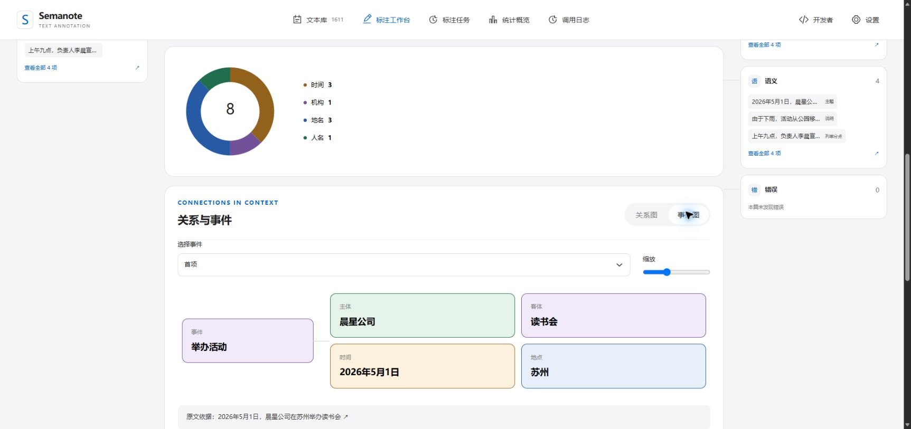
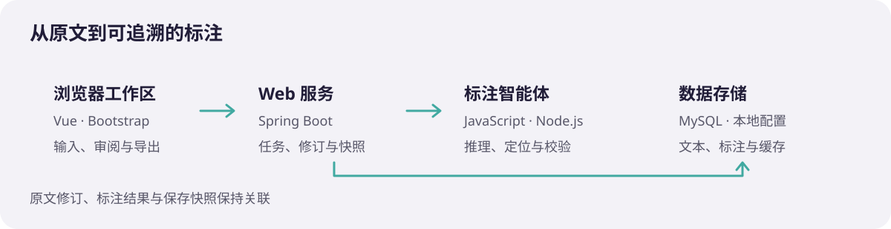

# Semanote-Agent

> 当前界面调整及验证状态见 [界面调整记录](docs/interface-refinement-report.md)。首页图为上一轮界面，使用原创合成数据。

**以原文为中心，完成可检查、可修正、可追溯的中文文本标注。**

Vue 3 · JavaScript · Bootstrap 5 ｜ Java 21 · Spring Boot ｜ JavaScript Agent · MySQL

[开始使用](#开始使用) · [标注能力](#标注能力) · [架构与设计](#架构与设计) · [验证与边界](#验证与边界)

从导入到审阅，在同一份原文上完成十一层标注。首页展示文本、任务与统计；进入工作台后，可对照原文检查和修正结果。

~~~text
导入 / 输入 → AI 候选 → 审阅与人工修正 → 保存快照 → 统计与导出
              JavaScript Agent          Java / MySQL
~~~

- 原文可叠加分词边界、关键词、词性和实体标记；点击结果可定位原文。
- 自动结果先作为候选，人工修正后可保存快照。原文修改会产生新修订，历史标注保留在对应版本。
- 统计和逐篇图谱展示当前选定版本；模型日志按日期展示已知 Token 用量和供应商缓存命中率。
- 相同文本块可复用成功结果，失败层需显式重试；未知用量不会当作零。

## 开始使用

运行环境：**Windows、Java 21、Node.js 24**。首次源码构建需要 npm、Maven 和便携 MySQL；工具只放在本项目 profile/tools，不全局安装。整个当前项目不依赖 Python。

~~~powershell
# 项目根目录，首次从源码准备与构建
node tools/download-web-tools.mjs
node tools/build-web.mjs
node tools/local-web.mjs start
~~~

已有构建产物时，只需最后一条启动命令。打开 [本地工作台](http://127.0.0.1:8080/)：

1. 顶部「设置」→「模型供应商」，配置自己的地址、模型和密钥。预置 DeepSeek、阿里云百炼，可自定义 OpenAI 兼容服务。
2. 新建一段原创文本或导入文件，打开文本后选择「自动标注」。仅向已获授权的服务发送有权外发的内容。
3. 检查两侧卡片和正文图层，按需人工修正，保存后导出 JSON、TXT 或 Markdown。

密钥只保存在本机受忽略配置，读取时不回显。无模型也可进行人工标注与本地无损分段。

[完整运行 / 局域网 / 备份 / 离线构建](docs/web-usage.md) · [独立智能体 / 缓存 / 显式重试](docs/agent-usage.md)

## 标注能力

| 标注层 | 结果与交互 |
|---|---|
| 分词、词性 | 原文词项与 UD 17 类词性；词性固定引用同修订分词 |
| 关键词、命名实体 | 关键词频次与全部精确位置；人名、地点、机构、时间、金额按语境定位 |
| 分段、语义 | 无损分段、主题、解释及列举分点；视觉换行保持原文内容与顺序 |
| 关系、事件 | 主客体、主体/客体/时间/地点/原因/结果角色及原文依据；明确日期进入事件时间轴 |
| 情感、意图 | 正面/负面/中性，以及陈述/请求/提问等；自动结果完整覆盖非空白原文 |
| 错误 | 语法、用词、错别字、标点候选及建议；不会直接改写正文 |

导入支持 DOCX、UTF-8 TXT、Markdown、三列 CSV。单文本最多 10,000 码点、单文件 5 MiB、单批 500 文本。TXT/MD/DOCX 每文件一份正文，CSV 每格独立，保留来源行列；空白跳过并报告。

## 架构与设计

| 层 | 实现与职责 |
|---|---|
| 浏览器 | Vue / JavaScript / Bootstrap：沉浸工作区、人工编辑、逐篇图谱 |
| Web 服务 | Java / Spring Boot / JDBC：REST、任务、修订、快照、导入导出、并发保护 |
| 智能体 | Node.js 原生 JavaScript：合并推理、分块、原文定位、依赖校验、缓存与脱敏日志 |
| 存储 | MySQL 8.4 业务版本；本机文件保存配置、推理缓存与调用元数据 |

[独立开发者中心](http://127.0.0.1:8080/developer) 提供设计规范、Bootstrap 组件展示、系统框架、调用日志和 Git 时间轴。系统图节点可进入前端、后端、智能体和数据库框架。

[系统 Archify](docs/diagrams/system-architecture.html) · [智能体 Archify](docs/diagrams/agent-architecture.html) · [Apple 来源设计规范](docs/design/README.md) · [Web 契约](docs/web-contract.md) · [标注契约](docs/annotation-contract.md)

## 验证与边界

已发布基线为 [0.1.1](https://github.com/Ceeyu-iooi/Semanote-Agent/releases/tag/0.1.1)；当前沉浸工作区改造的实施与验证单独记录，未创建新版本标签。[0.1.1 验证](docs/0.1.1-report.md) · [本轮实现与验证](docs/immersive-report.md) · [本轮需求](docs/immersive-requirements.md) · [20 篇 README 提炼](docs/readme-research.md)

2026-11-01 继续优化 Bootstrap 手风琴、频次详情、人物关系图、事件时间轴、统计层级、统一动效和真实任务进度。[优化需求](docs/interaction-requirements.md) · [十五轮交互验证与恢复](docs/interaction-report.md)

用户要求重新逐项实施后的补充改动、失败试验与复核记录见 [交互补验报告](docs/interaction-rework-report.md)，当前仍待用户验收。

- 自动结果为待审阅候选。格式与字符覆盖检查不等于语言学准确率；CSV 没有标准答案，跨块关系和歧义指代仍需人工检查。
- 当前为单人工作流。局域网访问者共享同一空间，无独立账户、角色权限或任务分配。
- profile 存放原件、受限语料、配置、数据库、备份和回执，整个目录忽略。课程 CSV 不随公开仓库分发；本机存在时可幂等导入初始语料。
- 真实语料外发按服务和范围授权，本轮百炼只验证原创合成文本。
- 项目尚未选择整体开源许可证；公开可见不等于已授予复用许可。[第三方许可证](docs/licenses)

开发、目录与课程资料

~~~text
frontend/   Vue 界面与共享交互
backend/    Java Web 服务、SQL 与测试
agent/      JavaScript 智能体与独立 CLI
examples/   原创合成请求和评估案例
docs/       契约、设计、Archify、决策与验收
tools/      Node 构建、运行、验证、备份与同步
profile/    本机数据与凭据，不公开
~~~

Vue/Bootstrap 已编译进 frontend/dist，成品运行无需 node_modules。恢复开发依赖：npm ci --prefix frontend。重建前先 node tools/local-web.mjs stop，构建通过再 start；离线依赖复用方式见运行说明。

~~~powershell
node --test agent/*.test.js frontend/tests/*.test.js tools/tests/*.test.mjs
node tools/verify-web.mjs
node tools/sync-workflow.mjs --check
node tools/verify-initialization.mjs --audit-data --expect-git
~~~

流程仅编辑 docs/workflow.json，再运行 node tools/sync-workflow.mjs。历史 Python 实现可在0.1.1标签查看；初始化标签 v0.1.0-docs.1 保持不变。

[工作规范](AGENTS.md) · [五步流程](docs/workflow.md) · [需求](docs/requirements.md) · [PRD](docs/PRD.md) · [数据库](docs/database.md) · [决策](docs/decisions.md) · [验收](docs/acceptance.md) · [课程清单](docs/submission-checklist.md) · [GitFlow](docs/git-workflow.md) · [Changelog](CHANGELOG.md)

