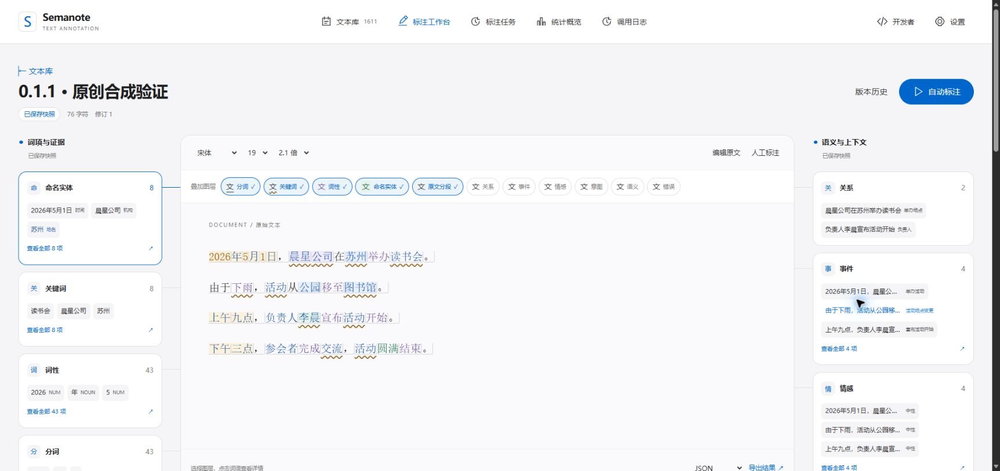
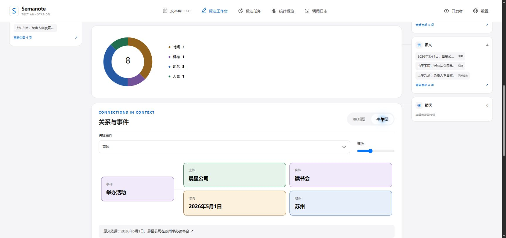

# Semanote-Agent

**把原始文本变成可检查、可修正、可追溯的标注。**

Vue + JavaScript + Bootstrap 工作台 · Java / Spring Boot 后端 · JavaScript 智能体 · MySQL

[开始使用](#开始使用) · [支持的标注](#支持的标注) · [架构与设计](#架构与设计) · [验证记录](docs/0.1.1-report.md)

> **版本 0.1.1**：[发布记录与源码](https://github.com/Ceeyu-iooi/Semanote-Agent/releases/tag/0.1.1)。本版提供十一层标注与完整 Web 工作流；课程验收及语义质量评估单独记录。历史初始化标签 `v0.1.0-docs.1` 继续保留。



## 从一段文字开始

导入或输入文本，选择标注任务，审阅自动候选，再按需要人工修正。保存后形成不可变快照：正文、标注、统计与导出始终对应同一修订。

```text
原文 → 自动标注 → 审阅 / 人工修正 → 保存快照 → 统计与导出
       JavaScript 智能体              Java / MySQL
```

- **看得清**：分词边界、关键词波浪线、词性色彩和实体底色可以叠加；悬停提示、类别筛选和频次排序帮助定位细节。
- **改得准**：原文编辑与标注编辑分开；选区使用 Unicode 码点，兼容 emoji、重复片段及重叠标注。冲突保留本地输入，旧标注留在历史修订。
- **有依据**：每篇正文后都有当前展示版本的柱图、雷达图、实体环图及关系/事件卡片；明确区分候选、草稿与已保存快照。
- **少重复**：同一原文块合并推理，成功层可缓存复用；调用日志记录实际请求、耗时和 token，失败由用户显式重试。



<a id="支持的标注"></a>

## 支持的标注

| 标注 | 得到什么 |
|---|---|
| 分词 / 词性 | 完整原文词项及对应 UD 17 类词性 |
| 关键词 / 命名实体 | 原文关键词、全部精确出现位置；人名、地点、机构、时间、金额 |
| 原文分段 / 语义 | 无损分段、主题与列举分点；视觉换行不会重写原文 |
| 关系 / 事件 | 主客体、事件角色和原文证据；有明确日期的事件可查看时间轴 |
| 情感 / 意图 | 句子正面、负面、中性判断，以及陈述、请求、提问等意图 |
| 错误 | 语法、用词、错别字、标点候选及修改建议；建议不会直接改写正文 |

支持 DOCX、UTF-8 TXT、Markdown、三列 CSV 导入，以及 JSON / TXT / Markdown 快照导出。单文本最多 10,000 码点，文件 5 MiB，常规导入或批量操作最多 500 份文本。

<a id="开始使用"></a>

## 开始使用

运行环境：**Windows、Java 21、Node.js 24、Python 3.12**。Node 负责活动智能体，Python 负责启动、构建与维护工具。便携 MySQL / Maven 放在本地 `profile/tools`。

已有构建产物时，在项目根目录运行：

```powershell
python -X utf8 -B tools/local_web.py start
```

打开 [文本工作台](http://127.0.0.1:8080/) → 左下角「设置」→「模型」，填写自己的供应商地址、模型和密钥。预置 DeepSeek 与阿里云百炼，也可添加其他 OpenAI 兼容接口；密钥只写入本机配置，读取接口不回显。

首次从源码构建：

```powershell
python -X utf8 -B tools/download_web_tools.py
python -X utf8 -B tools/build_web.py
python -X utf8 -B tools/local_web.py start
```

[完整操作、局域网、备份与恢复](docs/web-usage.md) · [智能体调用与缓存](docs/agent-usage.md)

局域网共享使用 `tools/local_web.py lan`，再由管理员运行 `tools/configure_lan.ps1`。同网段访问者共享一个工作空间；当前没有登录与权限分配，MySQL 保持回环监听。

<a id="架构与设计"></a>

## 架构与设计

| 层 | 实现与职责 |
|---|---|
| 浏览器 | Vue 3 / JavaScript / Bootstrap 5：文本编辑、交互标注、逐篇可视化 |
| Web 后端 | Java 21 / Spring Boot 3.5 / JDBC：接口、任务、修订、快照、导入与导出 |
| 智能体 | Node.js 24 原生 JavaScript：多任务合并推理、分块、原文定位、缓存与校验 |
| 持久化 | MySQL 8.4 保存不可变业务版本；本地文件保存受限配置、调用元数据和推理缓存 |

[开发者中心](http://127.0.0.1:8080/developer) 是独立页面，提供 Apple 来源设计 preview、六份 Archify 图、实际 Git 历史/代码差异、调用日志和 Changelog。

[系统 Archify](docs/diagrams/system-architecture.html) · [智能体 Archify](docs/diagrams/agent-architecture.html) · [共享设计规范](docs/design/README.md) · [Web 契约](docs/web-contract.md) · [标注契约](docs/annotation-contract.md)

## 验证与边界

0.1.1 的八组迭代、真实调用/离线回放区别、同文成本对照、保存恢复及桌面/窄屏检查，见 [验证记录](docs/0.1.1-report.md)。模型结构校验和字符覆盖不能替代语言学准确率评估，CSV 未提供标准答案。

- 自动结果始终是待审阅候选；跨块的长距离关系和歧义指代需要人工检查。
- 目前是单人工作流，多用户任务分配保留扩展设计。
- `profile` 存放本地原件、受限语料、配置、数据库、备份与验证回执，整个目录不进入公开仓库。首次没有课程原件时，系统仍可用原创文本运行。
- 真实语料外发按服务和范围授权；本轮百炼验证只使用原创合成文本。
- 公开可见不代表授予开源许可：项目尚未选择开源许可证，第三方许可见 [许可证资料](docs/licenses)。

<details>
<summary>目录、开发恢复与课程文档</summary>

```text
frontend/         Vue 工作台、独立开发者页面
backend/          Java 后端、数据库结构与测试
agent/            活动 JavaScript 智能体，无第三方运行依赖
semanote_agent/   P03 历史 Python 交付兼容
examples/         可公开原创合成样例
docs/             契约、设计、Archify、决策与验收
tools/            构建、启动、验证、备份和文档同步
profile/          本机数据与凭据，Git 忽略
```

前端 Vue/Bootstrap 已打包进 `frontend/dist`，运行成品不需要 `frontend/node_modules`；活动智能体仍需 Node.js。恢复开发依赖使用 `npm ci --prefix frontend`。Windows 重建前先执行 `tools/local_web.py stop`，再运行 `tools/build_web.py`，通过后重新 start，避免运行中的 JAR 被锁定。

[工作规范](AGENTS.md) · [开发流程](docs/workflow.md) · [需求映射](docs/requirements.md) · [PRD](docs/PRD.md) · [数据库设计](docs/database.md) · [决策](docs/decisions.md) · [验收](docs/acceptance.md) · [课程提交清单](docs/submission-checklist.md) · [GitFlow](docs/git-workflow.md) · [Changelog](CHANGELOG.md)

流程状态只编辑 `docs/workflow.json`，再执行：

```powershell
python tools/sync_workflow.py
python tools/sync_workflow.py --check
python tools/verify_initialization.py
```

</details>
