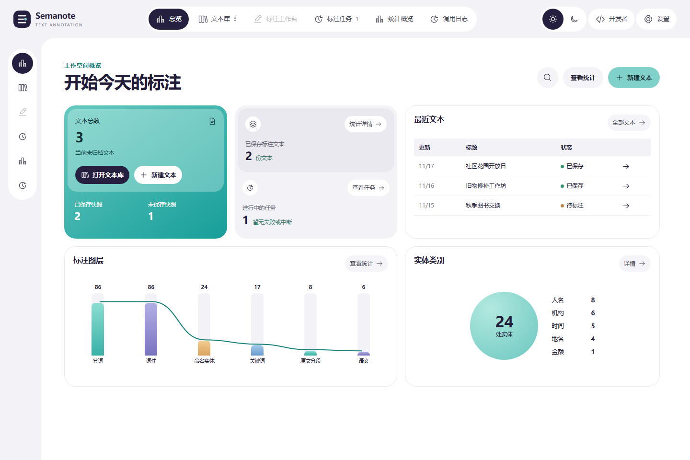
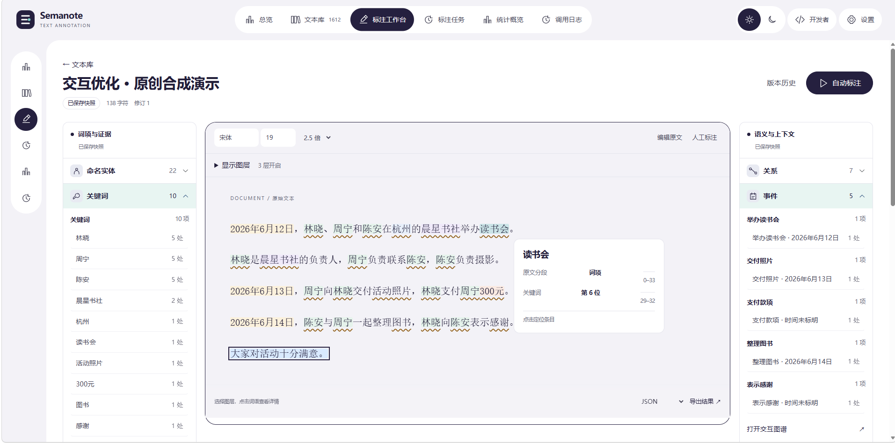
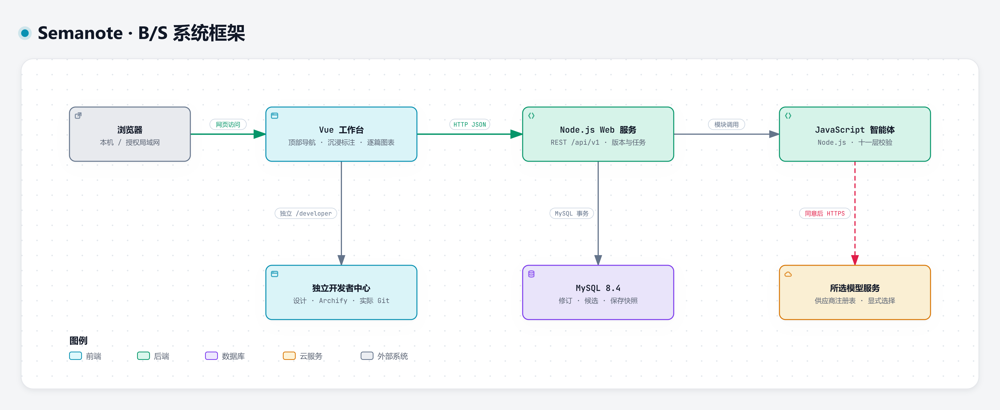

  
  <h1>Semanote-Agent</h1>
  
<em>在原文旁查看、修正和保存中文标注。</em>

  
  
  
  

  <a href="#标注能力">标注能力</a> · <a href="#开始使用">开始使用</a> · <a href="#架构与设计">架构与设计</a> · <a href="#数据和隐私">数据和隐私</a> · <a href="#常见问题">常见问题</a> · <a href="#致谢">致谢</a>

## 简介

Semanote-Agent 是一个在本机运行的中文文本标注工作台。导入文本后，可以生成十一类标注候选，在原文中核对和修正，再保存为快照。已保存的结果可查看词云、关系图和事件时间轴，也可导出为 JSON、TXT 或 Markdown。

## 标注能力

<table width="100%">
  <thead>
    <tr><th scope="col">图层</th><th scope="col">标注结果</th><th scope="col">如何查看</th></tr>
  </thead>
  <tbody>
    <tr><td>分词、词性</td><td>中文词语边界和 UD 词性标签</td><td>在正文中叠加分词边界，按词性类别核对对应词语。</td></tr>
    <tr><td>关键词、命名实体</td><td>关键词，以及人名、地点、机构、时间和金额</td><td>用词云查看关键词频次，在侧栏按实体类别定位原文。</td></tr>
    <tr><td>分段、语义</td><td>段落边界、主题、说明与列举</td><td>按段落阅读原文，在语义侧栏查看片段及其类别。</td></tr>
    <tr><td>关系、事件</td><td>实体之间的联系、事件角色及时间</td><td>点击关系连线查看证据，按时间轴浏览有明确日期的事件。</td></tr>
    <tr><td>情感、意图</td><td>正面、负面、中性，以及陈述、请求、提问等意图</td><td>在标注详情中按类别查看，点击条目回到原句。</td></tr>
    <tr><td>错误</td><td>用词、语法、错别字和标点问题</td><td>对照原文检查建议，由人工决定是否修改。</td></tr>
  </tbody>
</table>

## 开始使用

### 1. 安装

需要 Windows x64、Git、JDK 21 和 Node.js 24。

~~~powershell
git clone https://github.com/Ceeyu-iooi/Semanote-Agent.git
cd Semanote-Agent
node tools/setup.mjs
~~~

安装后，双击项目根目录的 [start.bat](start.bat) 打开工作台。

### 2. 更新

~~~powershell
git pull --ff-only
node tools/setup.mjs
~~~

### 3. 供应商配置

在「设置 → 模型供应商」填写接口地址、模型和 API Key。

### 4. 标注与导出

在文本库新建或导入文本，核对标注后保存快照，再选择导出格式。

[运行手册](docs/web-usage.md)

## 架构与设计

- **工作台。** Vue 和 Bootstrap 构建文本库、标注编辑器与统计界面。选中标注可回到原文位置。
- **服务与存储。** Spring Boot 提供 API、管理导入和标注任务，MySQL 保存原文修订、候选和快照。
- **标注智能体。** Node.js 按任务调用所选模型，并在本地校验返回的标注与原文位置。
- **开发者中心。** 可从系统图进入各模块架构，也可查看设计规范、模型调用日志和 Git 时间轴。

[设计规范](docs/design/README.md) · [Web 契约](docs/web-contract.md) · [标注契约](docs/annotation-contract.md)

## 数据和隐私

- **本机保存。** 文本、修订和标注快照存入本机 MySQL。供应商配置、密钥、缓存和备份存放在本地 `profile/`，该目录不纳入 Git。
- **模型请求。** 导入和人工标注在本机完成。使用远程模型自动标注时，请确认有权外发文本，服务端会把待标注内容发送给所选供应商。
- **访问范围。** 当前是单人工作台。开启局域网访问后，同网段设备共享同一工作区，部署时请限制访问范围。

## 常见问题

| 问题 | 处理方式 |
| --- | --- |
| 页面打不开 | 双击 `start.bat` 查看启动结果，再按 [运行手册](docs/web-usage.md) 排查。 |
| 模型调用失败 | 核对供应商地址、模型和 API Key，在「调用日志」查看状态，然后重试任务。 |
| 没有 API Key 能用吗？ | 可以使用文本管理、人工标注和本地分段。 |
| 导出怎么没有刚修改的内容？ | 先保存当前修订的标注快照，再导出该快照。 |

## 致谢

感谢 Vue、Bootstrap、Spring Boot、Node.js 和 MySQL 社区。

## 许可证

本项目原创代码采用 [MIT 许可证](LICENSE)。第三方组件和素材沿用各自的许可。[第三方许可证](docs/licenses) · [供应商标识来源](docs/design/provider-assets.md)
