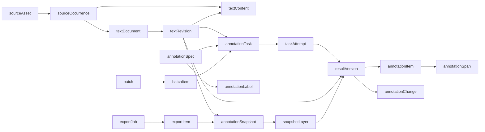

# 文本标注系统数据库逻辑设计

阶段：P01 初稿、P02 需求回看；日期：2026-10-27。P01 已获进入 P02 的用户指示，证据见 [验收记录](acceptance.md)；本次 P02 校正待用户验收。本文是表、字段和关系的逻辑设计，不是建库脚本或已实现的软件。

## 1. 规范化目标与设计边界

将本次需求收敛为可交付的表述：**设计支持通用中文文本输入、编辑、四类自动标注、人工标注/校对、统计、JSON 导出和批量处理的数据模型；原始来源、每次文本修订和每版结果可追溯，重新推理不覆盖人工成果，展示、统计和导出可固定到同一份已保存快照。**

分词、关键词、词性和命名实体四项均纳入；司法语料仅是本地示例。当前不增加登录、用户账户、多用户分配、文章、购物车或其他标注任务。

输入依据为 AGENTS.md、README.md、[课程要求](requirements.md)、[决策清单](decisions.md)、workflow.json、[数据审计](data-audit.md) 及本地 profile/manifest.json。后者只用于核对本地原件身份，不将原件、路径清单或真实文本复制进本文。

本次用户在阶段目标和技术清单中列出 MySQL，同时明确要求存储平台继续 TBD、技术选型仍待定。因此将 MySQL 记录为优先候选，持久化平台及备份方式仍为 **TBD[D03]**，不将冲突解释为已确认。字段物理类型、SQL 方言、键生成、索引实现与导出格式版本为 **TBD[D14]**；不选择 ORM，不连接或创建数据库。下文的 ID、文本、整数、时间和集合均为逻辑值域，不表示 SQL 类型。若后续确认 MySQL，再于 P04 确定其版本、字符比较规则、物理映射、迁移和备份恢复办法。

TBD[D07]、TBD[D13] 在 P01 可保留为设计建议，分别在 P02 梳理语义、P03/P04 实现前冻结；不阻止本次独立逻辑设计。本文涉及这两项的推荐行为不是已经生效的产品契约。

## 2. 文本身份、来源与版本

### 2.1 三种身份不能混用

| 身份 | 含义 | 是否可共用 |
|---|---|---|
| 内容身份 `contentId` | 精确相同的一段解码文本 | 可以共用；哈希只是候选匹配，仍核对全文 |
| 来源出现 `occurrenceId` | 一次导入中的一个单元格，或一次直接输入 | 每次出现分别保留，不能按内容去重删除 |
| 工作文本 `documentId` | 操作者管理、编辑和标注的独立对象 | 推荐每次出现各有一个，是否支持显式合并待 TBD[D13] |

原件字节由本地文件及其 SHA-256 保留；`textContent.contentText` 保存解析后的完整单元格文本，保持空格、换行、标点和字符，不做清洗归一。CSV 引号转义等文件语法仍可从原件复核，不能只靠解码后的字符串重建原始文件字节。

审计基线为 5,102 条数据记录、3 列、15,306 次文本出现、1,607 个精确不同文本、6 条重复整行、0 个空单元。列名“案件A/案件B/案件C”仅是来源元数据，不产生标签，也不表示分类、配对或标准答案。将来导入的空值必须记录其定位及处理结果，不能因本次数据无空值而省略异常设计。

### 2.2 建议采用的版本链（TBD[D13]）

`sourceAsset → sourceOccurrence → textDocument → textRevision → resultVersion → annotationSnapshot → exportItem`

- 文本首次保存产生初始修订；每次文本改动产生新修订，初始修订和父修订不可改写。
- 自动推理每次形成独立尝试及结果版本；人工从自动结果或已有人工结果创建新版本，也允许从空层开始人工标注。
- 结果只绑定一个确定的文本修订和一种标注任务。相同内容的两个工作文本不自动共享可编辑结果。
- 快照为同一修订选择各标注层的已保存结果；它可以明确不含某层，但不能隐式混入其他修订。
- 编辑后建议清空当前快照指向；旧结果仍供历史查看，显示其原修订，不自动把旧区间搬到新原文。
- “最新尝试”“最新成功自动版”“当前已保存快照”“人工已校对”是不同概念，不能用一个 `isLatest` 混代。

## 3. 字段清单

以下为 19 个逻辑实体，可在 P04 保持语义地合并物理表；不是要求建立 19 张物理表。所有名称采用有意义的英文 lowerCamelCase。`PK` 是逻辑主键，`FK` 是逻辑关联，`UQ` 是候选唯一约束；`?` 表示允许缺省，其余字段在相应记录有效时必须存在。建议状态词用于说明数据状态，最终枚举与接口字段由 TBD[D14] 冻结。外键名称及需要原子完成的组合见第 4 节。

### 3.1 来源与文本（5 个）

#### `sourceAsset`：一次可定位的输入来源

| 字段 | 含义与约束 |
|---|---|
| `sourceId` | PK，来源身份 |
| `sourceKind` | 文件或直接输入；不推导标签 |
| `sourceName?` | 原文件名/人工输入说明，只在本地保存 |
| `localReference?` | 本地原件引用；文件来源必需，不作为公开下载地址 |
| `fileFingerprint?`, `byteSize?` | 文件 SHA-256 与字节数；文件来源必需，不以同摘要禁止再次导入 |
| `encodingName?`, `parserVersion?`, `parseOptions?` | 解析所用编码、解析器版本和选项；文件成功解析后必需，规则待 TBD[D06] |
| `accessPolicyRef` | 本地使用/外发许可依据；真实数据不得因有引用就视为已获 TBD[D09] 授权 |
| `createdAt` | 来源登记时间 |

本地原件继续位于 profile；实际上传保存位置及其保留期待 TBD[D03]、TBD[D06]，不在本步创建新存储目录。

#### `textContent`：不可变的精确文本内容

| 字段 | 含义与约束 |
|---|---|
| `contentId` | PK |
| `contentText` | 完整文本，创建后不可改写；原始内容与编辑后内容均可引用 |
| `contentFingerprint` | 精确内容摘要，用于候选检索、重复分组；比较前不裁剪空白、不折叠大小写 |
| `fingerprintRuleVersion` | 摘要算法及文本编码约定；后续固定，不等同于标注区间单位 |
| `createdAt` | 首次登记时间 |

精确相同内容推荐复用同一 `contentId`；哈希碰撞时全文不同必须用不同 ID。不能直接使用数据库默认排序规则、忽略空格比较或仅哈希唯一键判断文本相同。长度可以推导；若缓存，必须同时记录计数规则版本，不能把审计中的 Python 字符数当作 TBD[D07] 的答案。

#### `sourceOccurrence`：保留每一次出现与导入定位

| 字段 | 含义与约束 |
|---|---|
| `occurrenceId` | PK |
| `sourceId` | FK → `sourceAsset` |
| `importBatchId` | FK → 导入类型的 `batch`；直接输入也可用单项录入批次表示 |
| `sourceRecordNumber` | CSV 逻辑数据记录序号，从 1 开始，不含表头；直接输入用该批次内序号 |
| `sourceColumnIndex` | CSV 从 1 开始的列序号；直接输入使用单一输入位置 |
| `sourceColumnName?` | 原始表头名称，仅作来源；同名列用列序号区分 |
| `physicalLineStart?`, `physicalLineEnd?` | 文件可提供时的物理行范围；CSV 带引号换行时不能与记录序号混淆 |
| `originalContentId?` | FK → `textContent`；成功解析时必需，无法解码时允许空并保留失败项 |
| `parseState`, `parseIssueCode?` | 成功、空值、拒绝或失败等导入结果及可定位原因 |
| `createdAt` | 出现登记时间 |

UQ：同一 `importBatchId + sourceId + sourceRecordNumber + sourceColumnIndex` 只有一项；重复提交同一导入请求复用该批次。明确再次导入使用新批次，保留另一组来源出现。不能以 `originalContentId` 唯一来吞掉重复来源。

若 TBD[D06] 确认纯文本 TXT 导入，按 [PRD](PRD.md) F03 的推荐采用单文件单文本，记录序号/列序号用单一逻辑位置，表头为空，不因文件中的换行拆成多篇；实际编码与解析选项保存在 `sourceAsset`。该位置约定是逻辑候选，不冻结物理类型或接口常量。

#### `textDocument`：独立管理和标注的工作文本

| 字段 | 含义与约束 |
|---|---|
| `documentId` | PK |
| `originOccurrenceId` | FK → 成功来源出现；推荐 UQ，落实一出现一工作文本 |
| `title?` | 可编辑显示名称，不作为内容或标签 |
| `originalRevisionId` | FK → 本工作文本的初始修订，建立后固定 |
| `currentRevisionId` | FK → 本工作文本当前修订 |
| `currentSnapshotId?` | FK → 本文当前修订的已保存快照；没有对应结果时为空 |
| `documentState` | 活跃或归档等状态；删除/撤销语义待 TBD[D13] |
| `stateVersion` | 当前指向的并发校验标记，防止多个页签静默覆盖 |
| `createdAt`, `updatedAt` | 建立与最近元数据/当前指向变更时间 |

#### `textRevision`：不可变的文本修订

| 字段 | 含义与约束 |
|---|---|
| `revisionId` | PK |
| `documentId` | FK → `textDocument` |
| `revisionNumber` | 文本内递增序号；UQ：`documentId + revisionNumber` |
| `parentRevisionId?` | FK → 同一工作文本的父修订；初始修订为空；禁止环 |
| `contentId` | FK → `textContent`；初始内容必须等于来源的 `originalContentId` |
| `revisionReason`, `editNote?` | 导入、直接输入、文本编辑等原因及可选说明 |
| `createdAt` | 修订保存时间 |

不在同一记录上更新原文。恢复历史文本也推荐创建新的修订并引用旧内容，是否允许直接切回历史指针待 TBD[D13]。文档与初始修订的双向关联须在一次原子保存中建立，不要求物理循环外键。

### 3.2 标注定义与执行（4 个）

#### `annotationSpec`：每类任务的规则版本

| 字段 | 含义与约束 |
|---|---|
| `specId` | PK |
| `taskType` | 分词、关键词、词性或命名实体的任务身份；具体值由 TBD[D14] 冻结 |
| `specVersion` | 规则版本；UQ：`taskType + specVersion` |
| `definitionRef`, `definitionFingerprint` | 对应规则文档/契约引用及摘要；仅有版本号不足以追溯规则 |
| `spanUnit?`, `endpointRule?`, `overlapRule?` | TBD[D07]；涉及区间的结果产生前必需 |
| `tokenizationRule?`, `keywordRule?`, `posMappingRule?` | 适用任务的粒度、关键词定义、词性与模型标签映射，待 TBD[D07] |
| `specState`, `createdAt` | 草案/已冻结等状态及创建时间；已冻结版本不原地改义 |

P01 不生成标签实例或规则默认值。草案不允许产生被称为已校验的正式结果。

#### `annotationLabel`：规则版本内的标签

| 字段 | 含义与约束 |
|---|---|
| `labelId` | PK |
| `specId` | FK → `annotationSpec` |
| `labelCode`, `labelName`, `labelDefinition` | 标签代码、显示名称、语义/使用说明；TBD[D07] |
| `labelState` | 可用/停用；已被使用的标签不得删除或改义 |

UQ：`specId + labelCode`。分词、关键词不强制伪造标签；词性和实体按已确认规则要求标签。标签修改通过新规则版本表达。CSV 列名不得导入本实体。

#### `annotationTask`：一次确定的单层标注请求

| 字段 | 含义与约束 |
|---|---|
| `taskId` | PK |
| `revisionId` | FK → 固定文本修订；不能只存 `documentId` 后运行时取最新原文 |
| `specId` | FK → 此次所用任务和规则版本 |
| `batchItemId?` | FK → 批次项；单篇操作可为空 |
| `requestKey` | 去重提交标记，UQ；重复点击/网络重传不会新增同一次请求 |
| `requestKind` | 首次自动标注或显式重新推理等意图 |
| `basedOnSnapshotId?` | 请求发起时看到的快照，仅用于上下文/冲突判断，不使其成为新自动结果 |
| `dependencyResultId?` | 若词性规则依赖已选分词，引用同修订的分词版本；否则为空 |
| `taskState`, `createdAt`, `finishedAt?` | 待处理、处理中、成功或失败等状态与时间 |

四类组合调用逻辑上产生四个单层请求，便于逐层报告失败；是否合并一次模型调用是 P03 实现选择，不改变每层可追溯性。重新推理使用新请求标记；同一请求的技术重试追加尝试。

#### `taskAttempt`：请求的一次真实执行尝试

| 字段 | 含义与约束 |
|---|---|
| `attemptId` | PK |
| `taskId` | FK → `annotationTask` |
| `attemptNumber` | 请求内序号；UQ：`taskId + attemptNumber` |
| `toolIdentity`, `toolVersion`, `adapterVersion` | 工具/供应商/模型声明版本和适配版本；具体选择 TBD[D04] |
| `inferenceConfig`, `configFingerprint` | 影响结果的非敏感配置、提示模板版本与摘要；不保存 API 密钥 |
| `externalRequestRef?` | 工具确有提供时的请求追踪号；不把不能固定的外部模型版本说成可完全复现 |
| `attemptState`, `startedAt?`, `finishedAt?` | 排队、执行、成功、失败或中断等真实状态 |
| `errorCode?`, `errorSummary?` | 失败必需；本地摘要，避免真实原文和凭据进入公开日志 |

成功必须有经结构校验的结果，合法空结果也可成功；失败不能伪造空结果。一次请求建议至多有一个未终结尝试，重试只针对已失败/中断尝试；已成功后的再次推理创建新请求。超时后的迟到回调必须核对尝试状态，不能将旧尝试重新发布为当前成功。原始供应商响应若确需保存，仅作受限本地诊断，保存范围与期限待 TBD[D09]、TBD[D13]，不是永久必留字段。

### 3.3 自动/人工结果与保存快照（6 个）

#### `resultVersion`：单修订、单标注层的完整不可变结果

| 字段 | 含义与约束 |
|---|---|
| `resultId` | PK |
| `revisionId`, `specId` | FK → 文本修订与规则版本，两者建立后不变 |
| `resultNumber` | 同修订、同任务类型内版本号；组合唯一 |
| `producerKind` | 自动或人工，不能从“是否有修改备注”猜测 |
| `attemptId?` | FK → `taskAttempt`；自动结果必需、人工结果为空；同一次单层成功尝试至多一个结果 |
| `baseResultId?` | FK → 同修订、同任务类型的上一版；校对必需，从空层人工创建时为空 |
| `dependencyResultId?` | 对应分词等依赖结果；必须与任务输入、同修订要求一致 |
| `reviewState` | 未校对/人工已保存/已确认等业务状态，最终口径 TBD[D13]；人工保存不自动成为金标准 |
| `validationRuleVersion`, `contentFingerprint` | 结构与区间校验规则版本、完整结果内容摘要 |
| `createdAt`, `revisionNote?` | 生成/保存时间及人工修订说明 |

版本保存完整结果而非只存补丁；可用 `annotationChange` 解释差异。自动版的修订、规则、依赖必须与其尝试所属请求完全一致；人工校对基线推荐使用同一规则版本，新规则转换须单独确认，不将改标签含义藏在普通校对里。基线关联不得成环。人工后又推理仍生成新的自动版本，不改写已有人工版，也不自动替换当前快照。成功且零条目可由“结果存在、条目数为零”表达；没有结果记录表示未完成/失败/未选择，二者不可混用。

#### `annotationItem`：一个词、关键词、词性项或实体项

| 字段 | 含义与约束 |
|---|---|
| `itemId` | PK |
| `resultId` | FK → `resultVersion` |
| `itemOrder` | 结果内稳定次序；UQ：`resultId + itemOrder` |
| `itemText` | 表面文本/关键词条目；与区间的精确对应要求由 TBD[D07] 确认 |
| `labelId?` | FK → 同 `specId` 的 `annotationLabel`；按任务规则必填或不适用 |
| `relatedTokenItemId?` | 若词性绑定分词项，FK → 已声明依赖分词版本中的项；不得跨修订 |
| `scoreValue?`, `scoreMeaning?` | 工具确实返回时才保留；有分数必有含义/来源，不能冒充准确率或校准置信度 |
| `rankValue?` | 若确认关键词按排序条目表达，保留工具/人工顺序依据 |

关键词可能是文档级词条，也可能是原文出现的片段，TBD[D07] 决定；未确认前不强制“一词条就是一个区间”，也不强制每类条目都有标签。

#### `annotationSpan`：条目在原文中的位置

| 字段 | 含义与约束 |
|---|---|
| `spanId` | PK |
| `itemId` | FK → `annotationItem` |
| `spanOrder` | 条目内位置次序；UQ：`itemId + spanOrder` |
| `startOffset`, `endOffset` | 按该结果 `annotationSpec` 的 TBD[D07] 单位和端点规则计数 |
| `surfaceText` | 原文切片校验值，必须与所绑定修订及已确认区间规则一致 |

一个条目可以有零个或多个位置，具体允许范围由规则限定：文档级关键词可无位置，多次关键词出现可逐处保存；分词、词性和实体的数量规则待 TBD[D07]。不因支持多位置而承诺不连续实体。验证边界、切片、顺序、重叠；重复词不能只用第一次字符串查找定位。Unicode/emoji、换行及端点换算在 P03/P05 验证。

#### `annotationChange`：人工保存时的差异记录

| 字段 | 含义与约束 |
|---|---|
| `changeId` | PK |
| `newResultId` | FK → 此次人工保存的新版本 |
| `changeOrder` | 同次保存内次序，组合唯一 |
| `changeKind` | 添加、修改、删除、拆分、合并或确认未修改等意图；最终值 TBD[D13] |
| `oldItemIds`, `newItemIds` | 基线版和新版的条目引用集合，支持拆分/合并；物理上可用关联表，不固定 JSON 类型 |
| `changeNote?` | 可选原因 |

添加的旧集合为空，删除的新集合为空；修改引用双方；旧项必须属于 `baseResultId`，新项属于 `newResultId`。纯确认可以没有条目变化但必须产生可追溯的保存/校对状态；人工从空层创建没有旧引用。不依赖账户表，操作者身份留存策略可在 TBD[D13] 确认，不擅自加入成员和登录字段。

#### `annotationSnapshot`：同一文本修订的已保存组合

| 字段 | 含义与约束 |
|---|---|
| `snapshotId` | PK |
| `revisionId` | FK → `textRevision` |
| `snapshotNumber` | 同修订内序号，组合唯一 |
| `parentSnapshotId?` | FK → 同修订的前一已保存快照；禁止环 |
| `snapshotFingerprint` | 文本修订、规则和各层结果选择的摘要 |
| `statisticsRuleVersion` | P02 增补：本快照正式统计的语义版本；具体计数定义待 TBD[D07]、TBD[D10]、TBD[D13]，推荐统计规则变化时显式新建快照，不改写历史含义 |
| `selectionNote?`, `createdAt` | 组合保存说明与时间 |

保存后不可改写。草稿未保存时不产生正式快照；草稿是否跨刷新保存待 TBD[D13]。快照可选择自动层和人工层的组合，但必须明确来源，不能隐式取各表“最新记录”。正式高亮/统计使用该快照；编辑区另作草稿预览，不改变正式统计/导出。`snapshotFingerprint` 也纳入统计规则版本。POS 依赖分词被替换时，必须选兼容 POS，或显式保存不含 POS 的组合，不能将不兼容旧层视为有效。

#### `snapshotLayer`：快照明确选择的标注层

| 字段 | 含义与约束 |
|---|---|
| `snapshotId` | FK → `annotationSnapshot` |
| `taskType` | 层身份；PK：`snapshotId + taskType` |
| `resultId` | FK → 同修订、同任务类型的一份已保存 `resultVersion` |

没有选中的层没有该层记录；是否允许导出不完整快照待 TBD[D13]。词性若依赖某分词版本，组合中选中的分词必须满足该依赖，否则拒绝保存并提示冲突。共享相同原文内容并不足以允许跨文档混层。

### 3.4 批量与导出（4 个）

#### `batch`：导入或标注的批次

| 字段 | 含义与约束 |
|---|---|
| `batchId` | PK |
| `batchKind` | 导入、自动标注等操作类型；不承诺额外队列基础设施 |
| `sourceId?` | FK → 单来源导入时的 `sourceAsset` |
| `requestKey` | UQ，同一操作重传复用，明确再次执行创建新值 |
| `requestedTaskTypes?`, `selectionPolicyVersion?` | 标注批次的任务集合及选择规则；不能随着全局设置改变历史批次 |
| `batchState`, `createdAt`, `startedAt?`, `finishedAt?` | 待处理、处理中、全部成功、部分失败或失败等逻辑状态 |

总数、成功数、失败数、处理中数由 `batchItem` 推导；若缓存必须可重算，不维护不能对账的第二套真值。

#### `batchItem`：批次中的单个来源/工作文本操作

| 字段 | 含义与约束 |
|---|---|
| `batchItemId` | PK |
| `batchId`, `itemNumber` | FK → `batch` 及批内序号；组合唯一 |
| `occurrenceId?` | FK → 导入项的来源出现；解析失败也保留定位 |
| `documentId?`, `revisionId?` | FK → 工作文本及固定修订；标注排队前必需，导入成功后填写 |
| `basedOnSnapshotId?` | 开始处理时的保存基线，供冲突检查 |
| `completedSnapshotId?` | P02 校正：本项已经保存的组合结果，必须与本项修订一致；部分失败项在显式确认缺层并保存后也可引用快照，不等同于全部成功 |
| `itemState`, `errorCode?`, `errorSummary?` | 单项真实状态及可定位错误；建议互斥为待处理、处理中、成功、部分失败、失败；每个层的成功/失败通过关联任务查询，错误详情不以此摘要代替 |
| `createdAt`, `finishedAt?` | 登记与结束时间 |

导入类型以每个单元格为一项；标注类型以一次确定工作文本/修订操作为一项。同一批次是否允许重复选择同一文档待 TBD[D13]；不得以内容相同去掉不同来源。重试沿用原项、追加失败任务的尝试；已成功层保留，能否只重试失败层及组合发布时机由 TBD[D13] 冻结。

P02 计数建议：总项数等于待处理、处理中、成功、部分失败、失败五种互斥项数之和；所选层全部成功且保存要求满足才记项成功，部分层失败记部分失败。重试中的项计处理中，历史失败尝试不删除。自动生成的已保存候选快照可以被历史/批次引用，不能因此自动替换已有人工当前快照。计数为推导值，最终状态/发布策略仍待 TBD[D13]。

#### `exportJob`：一次固定输入集合的 JSON 导出

| 字段 | 含义与约束 |
|---|---|
| `exportId` | PK |
| `requestKey` | UQ，重传复用同一导出请求 |
| `formatName`, `formatVersion` | 格式为 JSON；字段结构/版本为 TBD[D14] |
| `statisticsRuleVersion`, `countingBasis` | 统计规则版本与按出现/按不同内容等口径，待 TBD[D13]、TBD[D10] |
| `exportState`, `createdAt`, `finishedAt?` | 待生成、生成中、成功或失败等状态 |
| `artifactReference?`, `artifactFingerprint?` | 成功时的本地产物引用与摘要；不作为公开链接 |
| `errorCode?`, `errorSummary?` | 失败原因；失败不得提供旧文件冒充新成功 |

#### `exportItem`：导出固定的快照清单

| 字段 | 含义与约束 |
|---|---|
| `exportId`, `itemNumber` | FK → `exportJob`；组合 PK |
| `snapshotId` | FK → 不可变 `annotationSnapshot`，间接固定修订、内容和每层结果 |
| `sourceOccurrenceId` | FK → 该工作文本的来源出现，避免内容去重后来源丢失 |

导出开始前一次性固定清单；执行期间编辑、校对、切换当前版本不改变该清单。统计规则须与所选快照一致；跨规则快照需分组处理或拒绝同口径汇总，不能静默混算。来源元数据可在本地导出中保留，公开示例仅用原创合成文本；哪些文件名/定位字段进入导出待 TBD[D14]。P02 推荐缺层经明确提示/确认后可导出，合法空层与缺层用不同语义；纯原文/未标注文本的导出仍待 TBD[D13] 确认，不用空快照偷偷替代失败结果。

## 4. 关系与必须满足的约束

箭头表示关联方向/可追溯关系，不表示所有关系都是一对一。具体基数如下：

- 来源一对多出现；每次成功出现推荐对应一个工作文本；相同内容可被多次出现和多个修订引用。
- 工作文本一对多修订；同一修订有零到多个任务、各层结果和快照。
- 单层请求一对多执行尝试；单次成功尝试对应一个自动结果，失败无正式结果；人工结果无执行尝试。
- 规则版本一对多标签和结果；每个结果零到多个条目，每个条目按规则有零到多个区间。
- 每个快照每类任务至多选择一个结果；一个结果可被多个历史快照引用。
- 批次一对多批次项；单个标注项有一到四个所选层任务；导出任务一对多清单项。

| 约束 | 必须保留的不变量 | 最终检查位置 |
|---|---|---|
| C01 来源不丢失 | 同内容不同位置有不同出现身份；原始行序、列序、表头和原件摘要可追溯 | P04 导入与持久化 |
| C02 原文不可变 | 来源内容、已保存文本修订不能被编辑覆盖；内容摘要仅辅助检索 | P04 存储约束 |
| C03 修订绑定 | 原始/当前修订属于本工作文本；所有层和快照绑定同一修订 | P03/P04 结果与保存校验 |
| C04 自动人工隔离 | 自动版本必须追到执行尝试；人工版本通过基线与差异追踪；任一方不覆盖另一方 | P04 校对与重新推理 |
| C05 规则绑定 | 标签属于结果规则版本；区间按固定单位和端点校验，依赖分词版本匹配 | P03 契约与 P05 高亮 |
| C06 原子保存 | 新版条目、区间、差异和快照全部保存成功后才更新当前指向，任一步失败不能宣告成功 | P04 事务/等价原子机制 |
| C07 冲突可见 | 保存携带预期 `stateVersion` 和基线，文本或当前快照已变化时不静默覆盖 | P04 保存；P05 恢复提示 |
| C08 重传幂等 | 同一请求复用 `requestKey`；重试新增尝试，显式重新推理是新请求 | P04 请求与批量 |
| C09 统计一致 | 高亮、统计、导出使用同一已保存快照及统计规则；草稿不混入已保存统计 | P04/P05 |
| C10 空与失败分离 | 成功零条目、未执行、处理中、失败、部分失败分别可识别 | P03/P04/P05 |
| C11 历史引用有效 | 已被结果、快照、导出或评估引用的内容/规则不能直接级联删除 | P04 删除与恢复 |
| C12 重复隔离 | 未来金标准以精确内容组隔离集合，不能按 15,306 次出现随机分割后声称独立评估 | P03 评估设计 |

C03–C09 是当前推荐方案，业务操作细节仍受 TBD[D07]、TBD[D13]、TBD[D14] 的最终契约约束。允许将外键、跨记录校验和原子性分别落实在存储或业务层，但 P04 必须明确负责位置，不能仅靠前端约定。

逻辑检索建议：来源按批次/行列定位，内容按摘要候选检索，修订按文档/序号，结果按修订/任务/版本，区间按结果/次序，批次项按状态，导出按清单次序。这里只说明访问路径；物理索引、类型长度、字符集/排序规则和事务隔离级别继续 TBD[D14]。

## 5. 统计、导出与保留范围

统计本身不必成为一张独立事实表。单篇统计推荐固定 `snapshotId + statisticsRuleVersion`，从其 `snapshotLayer` 选中的结果计算实体数、关键词条目/出现数、词性和实体标签分布。批量统计固定快照清单并说明计数基准，不能把按出现次数统计称为不同文本数。标签统计使用规则版本和标签身份，不能只按同名标签合并。

关键词条目数、原文出现次数、排序分数是不同指标；是否按词面合并、空层如何显示、跨任务总量是否有意义等继续 TBD[D07]、TBD[D10]、TBD[D13]。缓存不是事实来源；如需缓存，键包含快照/清单、计数规则及计数基准，修改规则后不能复用旧数值。JSON 字段命名、区间表示、缺层/空结果表示、是否附带来源与统计等继续 TBD[D14]，本步不生成伪接口或示例响应契约。

P02 明确：没有原文位置的文档级关键词，其出现次数是未统计/不适用，不能用零次代替未知；统计规则变更按新快照表达。`exportJob` 的单一 `statisticsRuleVersion` 要求其清单中的快照规则一致；跨规则导出若未来支持，需分成多个同规则导出任务，或在 TBD[D14] 中扩展逐项规则记录，不能仅在文件中静默混算。当前推荐不增加逐项格式字段。

| 必须保留的事实 | 可推导/可重建 | 须另行确认 |
|---|---|---|
| 本地原件及文件摘要、每次出现的行列定位与内容关联 | 展示标题建议、文本长度、摘要检索缓存 | 上传保留期、删除与撤销、归档期限：TBD[D03]、TBD[D13] |
| 初始及后续修订、父链和精确内容 | 当前修订的历史列表 | 无变化保存、分支编辑、历史恢复策略：TBD[D13] |
| 规则版本、工具/适配配置、尝试状态和失败原因 | 批次计数、处理耗时 | 模型版本可获得程度、外部响应保存、诊断期限：TBD[D04]、TBD[D09]、TBD[D13] |
| 自动/人工完整结果、基线、人工差异、位置和依赖 | 显示高亮、统计面板、统计缓存 | 标签、区间及人工确认状态：TBD[D07]、TBD[D13] |
| 已保存快照、固定导出清单、格式与统计规则版本、产物摘要 | 在输入/规则齐全且格式实现兼容时重建导出 | 导出文件留存/访问范围、格式迁移：TBD[D13]、TBD[D14] |

人工校对记录不是人工金标准。后续若建立评估集，至少另存内容组身份、冻结的修订/金标准结果引用、标注准则版本、集合划分和复核记录；实体与字段在 TBD[D10] 确认后补充，不在 P01 伪造评估集和质量指标。

## 6. 数据生命周期与故障恢复

1. **登记来源**：只读核对原件身份；登记来源及导入批次。原件不覆盖，真实文本不外发。
2. **逐单元格导入**：每个逻辑记录的三列分别创建出现/批次项；精确内容可共用，来源不能合并。失败项保留坐标与原因，成功项原子创建工作文本及初始修订；重复请求不重复插入。
3. **输入与编辑**：直接输入也有来源出现；修改生成新修订，保留旧链。建议新修订暂无当前标注；旧页签保存通过基线冲突检查。空白、容量与格式校验待 TBD[D06]。
4. **推理或重新推理**：固定修订与规则，创建请求及尝试。各层记录真实成功/失败；成功零条目有效。执行时文本被编辑，任务仍属于原修订，不能发布到新修订的当前视图。
5. **人工标注/校对**：从指定基线或空层编辑；保存新完整结果与差异，选择组合快照。保存失败保持原快照可读，操作草稿是否恢复待 TBD[D13]；人工修订不修改原文。
6. **统计与导出**：选择已保存快照；统计与高亮使用同一版本。导出先冻结清单，后续编辑不改变输出；失败保留状态和原因，重试不静默切换快照。
7. **批次恢复**：每项固定目标修订，成功项保留，失败层定位到尝试。进程中断不能永久显示为成功；恢复时对未终结尝试进行核对/中断标记，再按确认规则追加尝试，不能无条件重跑全部并覆盖成果。
8. **归档与删除**：推荐先逻辑归档，物理清除须检查历史/导出/评估引用；尚无保留期或删除授权，不能把建议写成已确认策略。依据 TBD[D03]、TBD[D13] 确认后补充。
9. **备份与恢复**：P04 实施时将结构、数据、原件引用、规则、格式版本和应用版本一起核对；若确认 MySQL，按课程要求提供含结构与数据的本地 SQL 备份并实测恢复，禁止公开提交。备份频率、恢复点/恢复时间目标继续 TBD[D03]、TBD[D10]。本阶段没有数据库或备份产物，不能声称恢复验证通过。

## 7. P02 必须回看的问题

以下列出候选、影响和当前建议，仅供确认；相关决定的最终截止点以 decisions.md 为准，不将未回复视为采用建议。

| 问题 | 候选与影响 | 当前建议及受影响实体 | 决策 |
|---|---|---|---|
| Q01 MySQL 是否为正式选型 | 确认 MySQL，或继续平台无关设计；影响物理映射与备份，P01 均可逻辑设计 | 记录用户 MySQL 意向，待消除同条指令冲突；P04 前确认版本和恢复办法 | TBD[D03]、TBD[D14] |
| Q02 支持哪些导入 | 明确 CSV 与直接输入；是否另支持 TXT、编码探测/拒绝；影响来源定位与错误模型 | train.csv 按 UTF-8 BOM、三列独立解析；其他格式、空值及上限在 PRD 明列；`sourceAsset`、`sourceOccurrence` | TBD[D06] |
| Q03 重复文本如何管理 | 每次出现独立文档，或显式合并管理并保留多来源；影响编辑传播、计数和导出 | 一出现一工作文本、内容可共用，禁止静默传播编辑；`textDocument` | TBD[D13] |
| Q04 修改文本后旧结果如何呈现 | 新修订重新标注；或提供经验证迁移功能；后者增加区间变换和校对风险 | 保留历史、清空新修订当前快照，不自动迁移；`textRevision`、`annotationSnapshot` | TBD[D07]、TBD[D13] |
| Q05 分词与词性如何绑定 | POS 必须引用选中分词，或允许独立分词；影响跨层一致性 | 优先显式依赖，能力不符时展示差异；`dependencyResultId`、`relatedTokenItemId` | TBD[D07] |
| Q06 关键词是什么 | 文档级排序词条或带位置的原文短语；影响条目、位置、频次及人工编辑 | 先确认定义，再收紧条目/区间数量规则，不把分数叫准确率；`annotationItem`、`annotationSpan` | TBD[D07]、TBD[D10] |
| Q07 标签与区间规则 | 代码点、UTF-16 单位或其他单位；开/闭端点、嵌套/重叠与标签体系影响前后端转换 | 统一一个契约并用中文、emoji、换行和重复词验证；不默认具体规则；`annotationSpec` | TBD[D07] |
| Q08 人工保存意味着什么 | 仅保存、确认校对或审核完成；是否允许无变化确认；影响工作流和误用金标准 | 完整版本+基线+差异；状态明确；草稿是否持久化另确认；`resultVersion`、`annotationChange` | TBD[D13] |
| Q09 重新推理后选哪版 | 自动替换当前版，或保留人工版并显式选择；影响人工成果安全 | 保留各版，显式选择后新建快照；`annotationSnapshot`、`textDocument` | TBD[D13] |
| Q10 统计/导出基准 | 当前已保存版或含草稿；按出现或不同内容计数；是否允许缺层 | 使用固定已保存快照并显示计数基准；缺层明确提示；`snapshotLayer`、`exportJob` | TBD[D10]、TBD[D13]、TBD[D14] |
| Q11 批量失败与重试 | 全批原子或逐项提交；全项重跑或仅失败层重试；影响部分成功及成本 | 逐项保存、保留成功、重试失败层，旧修订结果不得冒充当前；`batchItem`、`taskAttempt` | TBD[D06]、TBD[D13] |
| Q12 删除、保留与恢复 | 归档/可撤销删除/物理清除；影响原件、历史与导出引用 | 先归档建议；确认保留期、引用保护和备份恢复；不无限期默认保存敏感响应 | TBD[D03]、TBD[D09]、TBD[D13] |
| Q13 规模、质量和课程安排 | 最大文本/批次、并发、响应时限、金标准抽样和阈值；真实成员及教学日期 | P02 登记可验收口径和缺失信息，数据不足不写数字目标；按内容组隔离评估 | TBD[D05]、TBD[D06]、TBD[D10]、TBD[D12] |
| Q14 技术清单的确认边界 | 用户列出 Vue/JavaScript/Bootstrap、Java/SpringBoot、大模型 API、MySQL；同时保留未定约束 | P02 前区分已确认组件与意向，版本、构建/包管理、供应商、授权及部署分别处理；不据清单启动构建 | TBD[D01]、TBD[D02]、TBD[D03]、TBD[D04]、TBD[D08]、TBD[D09] |

P02 回看方法：先记录 P01 用户验收位置及结论，再逐项处理 Q01–Q14；在 PRD 为每个动作写输入、成功、空、处理中、非法输入、失败和恢复条件。将每个条件映射到本文实体/约束，特别检查编辑失效、POS 依赖、人工保存、部分失败、统计与导出清单。决定变化时同步本文件与 decisions.md，列出新增/删除字段、兼容影响和未解决问题；P03 冻结标注契约后再复核，P04 才转物理结构并验证备份恢复。

## 8. P01 设计验收用例

下表是设计走查条件，不是数据库或业务测试的已通过记录。

| 用例 | 可通过/不通过的判断 | 数据支撑 |
|---|---|---|
| V01 直接输入、保存、重读 | 原文可从来源→初始修订取回，当前修订可独立改变 | 来源、内容、文档、修订 |
| V02 三列与重复导入 | 一轮完整成功导入应保留 15,306 次出现及其三列坐标；精确内容为 1,607 组；重复重传不新增，明确再导入新增来源出现 | 来源出现、批次、请求标记 |
| V03 四类结果 | 同修订四层均有独立规则/结果；一层合法空和一层失败能区分，标签不来自列名 | 请求、尝试、规则、结果、条目/区间 |
| V04 文本编辑 | 新修订不继续使用旧区间；历史修订/结果可查看；运行中旧任务不切换到新原文 | 修订绑定、快照当前指向 |
| V05 人工标注及校对 | 从空层或指定基线保存新人工版，添加/修改/删除/拆合可追溯；自动版仍可读取 | 完整结果、差异、快照 |
| V06 重新推理与冲突 | 追加尝试/新自动版，人工版不丢；陈旧页签保存不能静默覆盖 | 请求标记、尝试、`stateVersion` |
| V07 统计和 JSON 导出 | 同一快照的可见实体、关键词与标签计数可复算；导出生成期间编辑不会改变清单；缺层不冒充零结果 | 快照层、固定导出清单、计数规则版本 |
| V08 批量与恢复 | 各项/各层成功失败可定位；重试保留成功；进程中断可识别并恢复；总数可与单项对账 | 批次、批次项、请求/尝试 |
| V09 规则变化与引用保护 | 新规则不改变历史标签含义；跨修订/错误依赖组合被拒绝；已有导出引用不悬空 | 规则版本、依赖与引用约束 |

本阶段不实现导入器、不建立真实数据记录、不调用模型、不创建物理数据库。P01 的阶段准入证据已在 acceptance.md 记录；P02 PRD 与本次数据设计校正仍待用户验收。

## 9. P02 回看记录

需求依据为 [PRD](PRD.md) F01–F16、E01–E08。19 个逻辑实体保持不变，未生成物理表/SQL。

| 需求发现 | 设计校正 | 兼容影响与确认状态 |
|---|---|---|
| F13/F14：重读和导出应使用同版统计语义 | `annotationSnapshot.statisticsRuleVersion` 新增；摘要包含该版本；导出规则匹配快照，跨规则分组或拒绝汇总 | 逻辑设计尚未落地，无真实数据迁移；规则值仍 TBD[D07]、TBD[D10]、TBD[D13]，格式 TBD[D14] |
| F15：单项可有部分层失败 | 补全 `batchItem.itemState` 的部分失败口径；澄清 `completedSnapshotId` 可引用已明确保存的缺层组合；总项数按互斥状态对账 | 不增加实体；状态和自动保存/当前发布的细节待 TBD[D13]，候选快照不自动取代人工版 |
| F03：若支持 TXT，不能按行误拆 | 补充来源的单文件单文本定位候选，解析记录沿用现有来源字段 | 是否支持 TXT、编码和容量 TBD[D06]；不把候选当确认 |
| F04/F08/F11：草稿和分词依赖不能污染已保存视图 | 明确草稿预览独立；不兼容 POS 需重新选择/不包含，旧层留历史；没有新增草稿持久化实体 | 跨刷新草稿恢复未承诺；依赖与校对语义 TBD[D07]、TBD[D13] |

Q01–Q14 的逐项处置见 PRD 第 9 节；它们从“待梳理”进入“已梳理、待确认”，没有由 Agent 擅自变为 confirmed。P03 冻结契约、P04 物理落地前还需再次回看。
